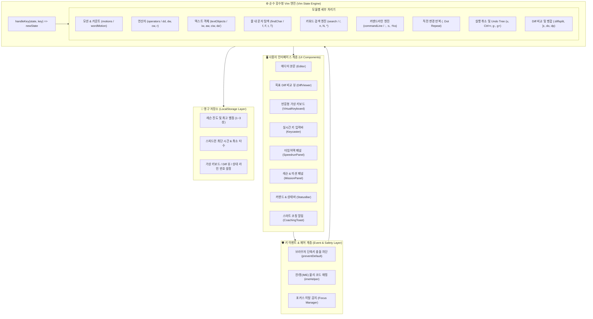

# ⌨️ VimPracticeOnWeb

> **브라우저에서 직접 키보드로 Vim 키바인딩과 모션, 텍스트 편집을 체계적으로 마스터하는 웹 기반 인터랙티브 Vim 시뮬레이터 & 튜토리얼 코스**

CodeMirror나 Monaco 같은 무거운 외부 에디터 라이브러리 없이, **순수 함수형 상태 전이 아키텍처(`(state, key) => nextState`)**로 구현된 가볍고 반응성이 뛰어난 웹 Vim 학습 플랫폼입니다.

---

## 🏛️ 시스템 아키텍처 (Architecture Diagram)



---

## 📋 지원하는 전체 Vim 명령어 (Command Cheat Sheet)

| 카테고리 | 키바인딩 / 명령어 | 기능 설명 |
| :--- | :--- | :--- |
| **모드 전환** | `i` / `a` | 현재 커서 위치(`i`) 또는 다음 칸(`a`)에서 INSERT 모드 진입 |
| | `I` / `A` | 줄 첫 번째 공백 아닌 문자(`I`) 또는 줄 맨 끝 다음 칸(`A`)에서 입력 진입 |
| | `o` / `O` | 현재 줄 아래(`o`) 또는 위(`O`)에 새 줄을 생성하고 INSERT 모드 진입 |
| | `Esc` | INSERT / VISUAL / COMMAND 모드에서 NORMAL 모드로 복귀 |
| | `v` / `V` / `Ctrl+v` | 글자 단위(`v`), 줄 단위(`V`), 직사각형 블록(`Ctrl+v`) VISUAL 선택 모드 |
| | `:` | 하단 커맨드라인 모드 활성화 |
| | `/` | 하단 키워드 검색 모드 활성화 |
| **기본 이동** | `h`, `j`, `k`, `l` | 좌(`h`), 하(`j`), 상(`k`), 우(`l`) 1칸 이동 (방향키 지원) |
| | `[count]h/j/k/l` | 카운트 배수만큼 이동 (예: `5j` ➔ 5줄 아래로, `10l` ➔ 10칸 우측) |
| **단어 이동** | `w` / `[count]w` | 다음 단어 첫 글자로 점프 (예: `3w` ➔ 3단어 점프) |
| | `b` / `[count]b` | 이전 단어 첫 글자로 점프 |
| | `e` / `[count]e` | 현재/다음 단어의 마지막 글자로 점프 |
| **줄 / 버퍼 이동** | `0` / `^` / `$` | 줄 맨 앞(`0`), 줄 첫 비공백 문자(`^`), 줄 맨 끝(`$`)으로 이동 |
| | `gg` / `G` | 버퍼의 첫 번째 줄(`gg`) 또는 마지막 줄(`G`)로 점프 |
| | `:[숫자]` / `[숫자]G` | 지정한 줄 번호로 즉시 점프 (예: `:10` 또는 `10G`) |
| | `%` | 현재/가장 가까운 `()`, `[]`, `{}` 괄호 짝으로 즉시 점프 (멀티라인 및 `d%`, `c%` 결합) |
| **줄 내 탐색** | `f{char}` / `F{char}` | 오른쪽(`f`) 또는 왼쪽(`F`)으로 `{char}` 문자를 찾아 즉시 커서 점프 |
| | `t{char}` / `T{char}` | 오른쪽(`t`) 또는 왼쪽(`T`)으로 `{char}` 문자 바로 직전(Till) 칸으로 점프 |
| | `;` / `,` | 직전 문자 탐색을 같은 방향(`;`) 또는 반대 방향(`,`)으로 반복 점프 |
| **키워드 검색** | `/검색어` + `Enter` | 버퍼 내 단어 실시간 하이라이트 및 첫 매치로 점프 |
| | `n` / `N` | 다음(`n`) 또는 이전(`N`) 검색 결과로 순환 점프 |
| | `*` | 현재 커서 아래 단어를 즉시 추출해 검색어로 등록 후 다음 매치 점프 |
| **삭제 및 수정** | `x` / `[count]x` | 현재 커서 글자 1개(또는 `count`개) 삭제 |
| | `dd` / `[count]dd` | 현재 줄(또는 `count`줄) 삭제 후 클립보드 저장 |
| | `dw` / `[count]dw` | 현재 커서부터 단어 끝까지 삭제 후 클립보드 저장 |
| | `cw` / `c[count]w` | 단어 삭제 후 즉시 INSERT 모드 진입 |
| | `cc` / `C` | 현재 줄 전체(`cc`) 또는 줄 끝까지(`C`) 삭제 후 INSERT 모드 진입 |
| | `r{char}` | 현재 글자 1개를 `{char}`로 교체하고 NORMAL 모드 유지 |
| | `p` | 클립보드에 복사/삭제된 줄 또는 텍스트 붙여넣기 |
| **텍스트 객체** | `ciw` / `diw` / `viw` / `daw` | 단어 내부(`iw`) 또는 공백 포함 단어 전체(`aw`) 삭제/수정/선택 |
| | `ci"` / `da"` / `ci'` / `da'` / `da``` | 큰따옴표/작은따옴표/백틱 내부(`i`) 또는 따옴표 자체 포함(`a`) 수정/삭제 |
| | `ci(` / `da(` / `ci[` / `da[` / `ci{` / `da{` | 소괄호/대괄호/중괄호 내부(`i`) 또는 괄호 자체 포함(`a`) 수정/삭제 (멀티라인 지원) |
| **치환 (Sub)** | `:%s/old/new/g` | 전체 버퍼에서 `old` 문자열을 `new` 문자열로 일괄 치환 |
| | `:s/old/new/g` | 현재 줄에서 `old` 문자열을 `new` 문자열로 일괄 치환 |
| **매크로 & 레지스터** | `q{reg}` ... `q` | `[a-z0-9]` 레지스터에 키 입력 시퀀스 녹화 및 녹화 배지 표시 |
| | `@{reg}` / `[count]@{reg}` | `{reg}` 레지스터에 녹화된 매크로 1회 또는 count회 실행 (재귀 방지 안전장치) |
| | `@@` | 가장 마지막에 실행했던 매크로 즉시 재실행 |
| **히스토리** | `.` (Dot) | 마지막 버퍼 변경 명령 시퀀스를 현재 커서 위치에서 동일하게 재실행 |
| | `u` | 실행 취소 (Undo) |
| | `Ctrl + r` | 다시 실행 (Redo) |

---

## 🎯 튜토리얼 커리큘럼 (Lessons 1 ~ 64)

### 🟢 기초 이동 및 텍스트 편집 (레슨 1 ~ 10)
1. **레슨 1**: 기본 방향 이동 (`h`, `j`, `k`, `l`)
2. **레슨 2**: 단어 단위 점프 (`w`, `b`, `e`)
3. **레슨 3**: 줄 끝 점프 (`$`)
4. **레슨 4**: 오타 삭제 (`x`)
5. **레슨 5**: 텍스트 입력 및 모드 복귀 (`i`, `Esc`)
6. **레슨 6**: 한 줄 삭제 (`dd`)
7. **레슨 7**: 단어 삭제 (`dw`)
8. **레슨 8**: 실행 취소 (`u`) & 되살리기
9. **레슨 9**: VISUAL 모드 영역 선택 및 일괄 삭제 (`v`, `d`)
10. **레슨 10**: 숫자 반복 카운트 활용 (`3w`, `2dd`)

### 🟡 효율적인 편집 가속 (레슨 11 ~ 19)
11. **레슨 11**: 빠른 입력 모드 진입 (`o`, `A`, `I`)
12. **레슨 12**: 빠른 단어 수정과 문자 교체 (`cw`, `r`)
13. **레슨 13**: 줄 내 문자 탐색과 삭제 (`f`, `t`, `df)`)
14. **레슨 14**: 텍스트 객체 내부 수정과 삭제 (`ciw`, `di"`)
15. **레슨 15**: 점(`.`) 명령어로 반복 편집 자동화하기
16. **레슨 16**: 키워드 검색과 점프 (`/`, `n`, `N`, `*`)
17. **레슨 17**: 커맨드라인 일괄 치환 (`:%s/old/new/g`)
18. **레슨 18**: 매크로 녹화와 괄호 점프 (`%` 및 `qa`, `@a`)
19. **레슨 19**: `Ctrl+v` 비주얼 블록 다중 줄 편집 (`I`, `Escape`)

### 🔵 실무 프로 생산성 & 고급 기능 (레슨 20 ~ 32)
20. **레슨 20**: 마크와 점프 리스트로 코드 순간이동 (`m`, `'`, `Ctrl-o`)
21. **레슨 21**: 실무 필수 라인/문자 편집 (`J`, `~`, `>>`, `<<`, `Ctrl-a/x`)
22. **레슨 22**: `:g` 글로벌 명령과 `:norm`으로 초고속 일괄 편집 (`:g/pattern/d`, `:norm`)
23. **레슨 23**: 블랙홀 레지스터 `"_` 와 명명된 레지스터 `"a` 활용하기 (`"ayiw`, `"_dd`, `"ap`)
24. **레슨 24**: `:vsp` 화면 분할과 창 간 코드 이동 (`:vsp`, `Ctrl-w l`, `"ap`, `"bp`)
25. **레슨 25**: JSX 태그 편집과 자동 들여쓰기 (`cit`, `gg=G`)
26. **레슨 26**: Insert 모드 고속 제어와 인버퍼 자동완성 (`Ctrl+w`, `Ctrl+n`)
27. **레슨 27**: `{}` 문단 점프와 `gi`, `gv`, `g;`로 편집 위치 복귀하기
28. **레슨 28**: 캡처 그룹 `\1`, `\2`와 `\u`로 snake_case 코드를 camelCase로 1초 만에 리팩토링하기
29. **레슨 29**: 타이핑 도중 `Ctrl+r 0`으로 변수명 붙여넣고 `Ctrl+r =`로 매직 넘버 계산하기
30. **레슨 30**: `cgn` + `.` 콤보와 `/pattern/e` 오프셋으로 초고속 정밀 타격하기
31. **레슨 31**: 대문자 `"A`로 흩어진 코드 수집하기 & 실수한 매크로에 `qA`로 명령 덧붙이기
32. **레슨 32**: `g Ctrl+a`로 배열 번호를 한 번에 매기고 `:sort u`로 중복 데이터 정제하기

### 🟣 순정 버퍼, 윈도우, 프로젝트 탐색, 폴딩, 퀵픽스, 전역 마크 & vim-surround (레슨 33 ~ 52)
33. **레슨 33**: `:bnext`, `:bprev`와 `Ctrl+^`로 여러 버퍼(파일) 자유자재로 넘나들기
34. **레슨 34**: `:tabnew`, `:tabclose`와 `gt`/`gT`로 여러 탭 페이지 워크스페이스 제어하기
35. **레슨 35**: `q:` 커맨드라인 윈도우와 히스토리로 과거 명령어 재사용 및 수정하기
36. **레슨 36**: 퀵픽스(Quickfix: `:cc`, `:cn`, `:copen`)로 코드 에러 순회 및 수정하기
37. **레슨 37**: 체인지 리스트(Change List: `g;`, `g,`, `:changes`)로 과거 편집 위치 탐색 및 복귀하기
38. **레슨 38**: 아규먼트 리스트(Arglist: `:args`, `:argdo`, `:n`)로 여러 파일 일괄 치환하기
39. **레슨 39**: 순정 파일 탐색기 Netrw(`:Explore`, `:E`)로 프로젝트 파일 탐색 및 열기
40. **레슨 40**: `.vimrc` 환경설정 버퍼 편집(`:e ~/.vimrc`) 및 실시간 소싱(`:source`, `:so %`)
41. **레슨 41**: 순정 ctags 심볼 점프(`Ctrl+]`)와 태그 스택 복귀(`Ctrl+t`)로 프로젝트 코드 탐색하기
42. **레슨 42**: 순정 diffsplit과 `]c`, `do`로 코드 변경점 비교 및 버그 패치 병합하기
43. **레슨 43**: 순정 경로 완성(`Ctrl+x Ctrl+f`) & 전체 라인 복제(`Ctrl+x Ctrl+l`)
44. **레슨 44**: 순정 Vim Undo Tree 시간 여행(`g-`, `g+`)과 과거 브랜치 복구하기
45. **레슨 45**: 순정 대소문자 변환(`gU`, `gu`, `g~` + 텍스트 객체/모션)으로 변수명 리팩토링하기
46. **레슨 46**: 린터/컴파일러 로그를 퀵픽스로 읽어와 점프하기 (`:cfile`, `:cn`, `:cp`)
47. **레슨 47**: 순정 코드 폴딩(`za`, `zo`, `zM`, `zR`)으로 대형 파일 탐색 및 특정 함수 리팩토링하기
48. **레슨 48**: 대화형 치환(`:%s/old/new/gc`)으로 안전하게 변수 선별 치환하기 (`y`/`n`/`a`/`q`)
49. **레슨 49**: 윈도우 로컬 로케이션 리스트(`:lvimgrep`, `:lopen`, `:lne`, `:lp`)로 현재 창 진단 및 수정하기
50. **레슨 50**: 순정 대문자 전역 마크(`mA`~`mZ`, `'A`~`'Z`)로 파일/버퍼 간 순간이동하기
51. **레슨 51**: 순정 키매핑 인터프리터(`:nmap`, `:nnoremap`)로 나만의 단축키 정의하고 실행하기
52. **레슨 52**: 사실상 Vim 필수 표준 플러그인 `vim-surround`로 괄호·따옴표 감싸고 변경하기 (`cs`, `ds`, `ysiw`, `yss`)

### 🎞️ 매크로 심화, 인덴트 객체, 사용자 정의 명령, 고급 Vim script, 정규식, 맞춤법, 파이프 & Netrw 고급 제어 (레슨 53 ~ 64)
53. **레슨 53**: 매크로 반복 실행(`@a`, `@@`, `3@@`)과 슬로우모션 매크로 디버거(1x / 0.5x / 0.2x, 키 단위 스텝 실행)로 매크로 검증하기
54. **레슨 54**: 인덴트 텍스트 객체(`ii`, `ai`, `aI`, `2ii`)로 YAML·Python 들여쓰기 블록 통째로 다루기 (`dai`, `cii`, `yii`, `vii`)
55. **레슨 55**: 사용자 정의 Ex 명령(`:command!`, `-nargs`, `-range`, `<args>`, `:delcommand`)으로 나만의 명령 만들기
56. **레슨 56**: Vim script 함수(`:function`, `:endfunction`, `:call`, `:[range]call`, `execute`)로 반복 작업을 함수로 만들기
57. **레슨 57**: Vim script 리스트·딕셔너리와 `getline()`, `map()`, `printf()`, `setline()`으로 버퍼 전체를 한 번에 가공하기 (`:for`, `=~`, `substitute()`, `filter()`)
58. **레슨 58**: 문단·문장 텍스트 객체(`ip`, `ap`, `is`, `as`)로 문서 구조 다듬기 (`dap` → `P` 로 문단 이동, `das` 로 문장 삭제)
59. **레슨 59**: 순정 Vim 정규식(`\zs`, `\d\+`, `\v`)과 `\=` 계산식 치환(`submatch()`)으로 설정 값 일괄 변경하기 (`:&&`, `g&`, `~`)
60. **레슨 60**: 보조 모션(`[(` `])` `[{` `]}`, `(` `)`, `ge` `gE`, `g_`, `+` `-` `Enter`, `|`)으로 정밀하게 이동하고 지우기
61. **레슨 61**: 순정 Vim 맞춤법 검사기(`:set spell`, `]s`, `[s`, `z=`, `zg`)로 오탈자 탐색 및 실전 교정하기
62. **레슨 62**: 고급 Vim script 람다(`{args -> expr}`)와 `sort()`로 글자 수(길이)순 정렬하기
63. **레슨 63**: 커맨드라인 파이프(`|`)와 한 줄 제어문(`:for`, `:if`)으로 다중 명령 일괄 자동화하기
64. **레슨 64**: 순정 Netrw 고급 탐색(`:Hexplore`, `:He`), 디렉터리 탐색, 신규 파일 생성(`%`)과 버퍼 제어(`Ctrl-^`) 마스터하기

---

## 💡 사용자 경험 & 시각적 학습 도구 (UX Tools)

- **🎯 목표 상태 Diff 비교 하이라이트 (Target Diff View)**:
  - 텍스트 편집 미션에서 사용자가 도달해야 하는 목표 코드와 현재 코드를 좌우로 나란히 비교합니다.
  - 아직 고치지 않은 불일치 라인은 붉은색 마커(`-`), 완성 목표 라인은 초록색 마커(`+`)로 직관적 힌트를 제공합니다.
- **⌨️ 반응형 인터랙티브 가상 키보드 (Virtual Keyboard)**:
  - QWERTY 키보드와 Vim 키 역할(이동, 수정, 입력, 선택, 탐색)을 시각적으로 안내합니다.
  - 실제 타이핑 시 키캡이 네온 골드로 실시간 점등(`vkey-pressed`)되며, 마우스 클릭으로도 실제 키 입력이 가능합니다.
- **⚡ 타임어택 스피드런 모드 (Speedrun Mode)**:
  - 5개의 무작위 코드 리팩토링 미션을 연속 격파하는 챌린지 모드입니다.
  - 실시간 스톱워치 타이머와 누적 타수를 기록하며, 개인 최고 기록(최단 시간 & 최소 타수)을 `localStorage`에 영구 보존합니다.
- **🛡️ 한/영 입력기(IME) 자동 감지 & 물리 코드 보정**:
  - 한글(두벌식) 상태에서 `ㅗㅓㅏㅣ`(h,j,k,l) 등을 입력해도 물리 키(`e.code`)를 기반으로 영문 Vim 명령어로 즉시 자동 변환합니다.
- **🖱️ 에디터 포커스 이탈(Blur) 보호**:
  - 창 바깥을 클릭하여 포커스를 잃으면 커서가 아웃라인으로 바뀌며, "클릭하여 에디터 포커스 활성화" 안내를 띄웁니다.
- **🏆 Vim Golf 별점 시스템 & 스마트 코칭**:
  - 레슨별 Par(최적 타수) 기준에 따라 1~3성 별점을 부여하며, 비효율적인 연타 패턴(h/j/k/l 5회 이상) 시 대안 팁을 안내합니다.

---

## 🛠️ 기술 스택 (Tech Stack)

- **Core**: React 19, TypeScript, Vite
- **Testing**: Vitest, React Testing Library (281개 단위/통합 테스트 100% 통과)
- **Styling**: Modern Pure CSS (Catppuccin Macchiato 테마)
- **Zero Dependencies**: 외부 에디터(CodeMirror, Monaco 등) 및 무거운 UI 프레임워크 없는 순수 TypeScript 아키텍처

---

## 🚀 로컬 실행 & 빌드 가이드

### 1. 패키지 설치
```bash
npm install
```

### 2. 로컬 개발 서버 실행
```bash
npm run dev
```
브라우저에서 `http://localhost:5173`으로 접속합니다.

### 3. 전체 테스트 실행 (Vitest)
```bash
npm test
```

### 4. 프로덕션 빌드
```bash
npm run build
```
빌드 결과물은 `dist/` 폴더에 생성됩니다.

---

## 🌐 프로덕션 웹 배포 가이드

### 🚀 배포된 라이브 사이트 (Live Demo)
- **GitHub Pages 접속 URL**: [https://typoscript.github.io/VimPracticeOnWeb/](https://typoscript.github.io/VimPracticeOnWeb/)

---

### 📦 GitHub Pages 자동 배포 설정 방법 (GitHub Actions 기반)

본 프로젝트는 최신 공식 GitHub Actions(`actions/deploy-pages@v4`) 기반의 아티팩트 배포 워크플로(`.github/workflows/deploy.yml`)가 구성되어 있습니다. 별도의 `gh-pages` 브랜치 오염 없이 빠르고 안전하게 배포됩니다.

#### 1단계: GitHub 저장소 Settings 설정
1. GitHub 저장소 상단의 **`Settings`** 탭으로 이동합니다.
2. 좌측 사이드바 메뉴에서 **`Pages`** 항목을 클릭합니다.
3. **`Build and deployment`** 섹션의 **`Source`** 드롭다운 메뉴를 기존 `Deploy from a branch`에서 **`GitHub Actions`**로 변경합니다.

#### 2단계: 자동 배포 파이프라인 구동
- `main` 브랜치에 새로운 커밋이 `push`되거나, GitHub의 **`Actions`** 탭에서 **`Deploy VimPracticeOnWeb to GitHub Pages`** 워크플로의 `Run workflow` 버튼을 클릭하면 배포가 시작됩니다.
- 배포 파이프라인은 아래 단계를 자동으로 수행합니다:
  1. `npm ci`: 의존성 패키지 클린 설치
  2. `npm run test -- --run`: 281개 Vitest 단위/통합 테스트 전체 통과 검증
  3. `npm run build`: 리포지토리 베이스 경로(`/VimPracticeOnWeb/`)가 적용된 정적 사이트 번들링
  4. `actions/deploy-pages`: GitHub Pages CDN으로 즉시 무중단 배포

---

### ☁️ 기타 호스팅 플랫폼 배포

#### Vercel 배포
1. [Vercel](https://vercel.com)에 로그인 후 GitHub 저장소 `VimPracticeOnWeb`을 Import합니다.
2. Build Command: `npm run build`
3. Output Directory: `dist`
4. Deploy 버튼을 누르면 수 초 내에 전 세계 엣지 네트워크로 자동 배포됩니다.

#### Netlify 배포
1. Netlify 대시보드에서 `Import an existing project` 선택
2. 빌드 명령어: `npm run build`, 게시 디렉터리: `dist` 지정 후 배포
